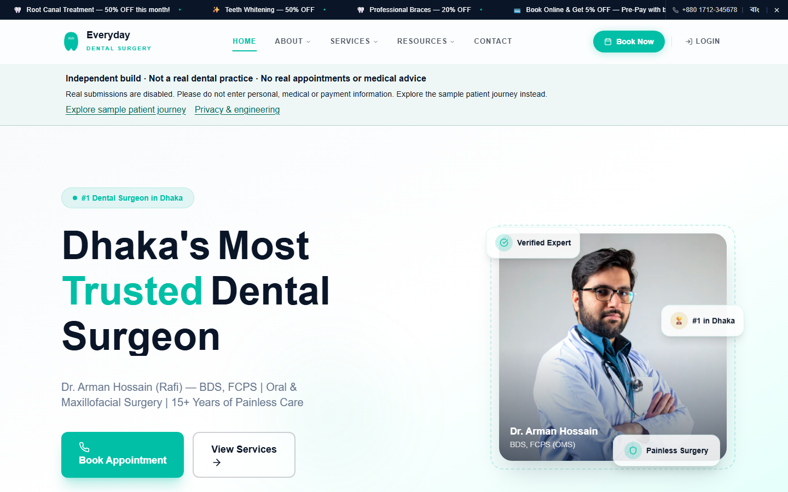
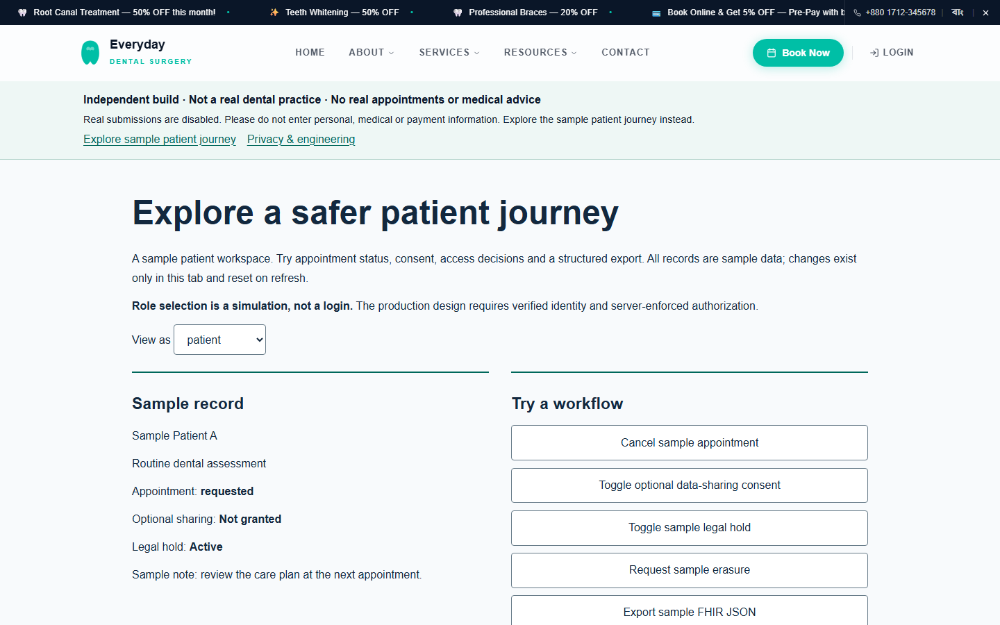
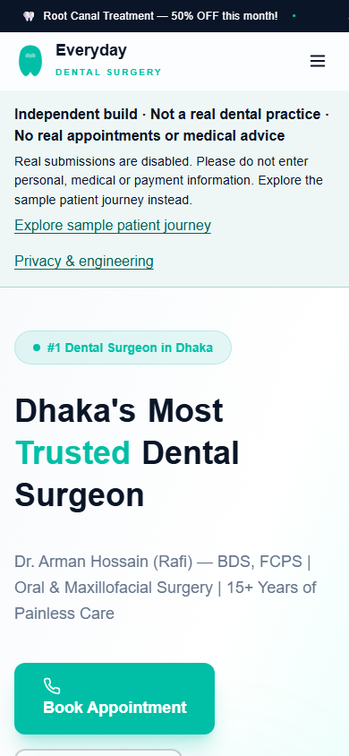
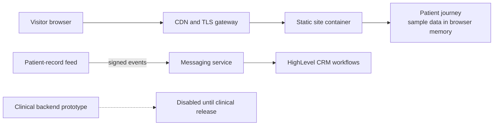

# Everyday Dental Surgery

A bilingual (English / বাংলা) dental clinic website and patient platform, built with React and Vite. It pairs a polished public site with an interactive patient-records demo, a campaign messaging service connected to the HighLevel CRM, and a documented path to a production clinical system.

**[Live site](https://dental.zahidul-islam.com)** · [Documentation](docs/README.md) · [Architecture](docs/ARCHITECTURE.md) · [Roadmap](ROADMAP.md) · [Changelog](CHANGELOG.md)



> **Portfolio project.** Everyday Dental Surgery is a fictional practice. Its clinicians, prices, reviews and contact details are sample content, and the site does not accept real appointments, patient data or payments. See [Project status](#project-status).

## Highlights

- **Full clinic website.** Home, about, services with detail pages, pricing, blog, FAQ, gallery, community and conference pages, in English and Bangla with a one-click language switch.
- **Interactive patient journey.** The [`/experience`](https://dental.zahidul-islam.com/experience) page lets visitors act as a patient, receptionist, clinician or administrator on a sample record: cancel an appointment, grant or withdraw consent, place a legal hold, request erasure and export the record as FHIR-style JSON. Each action records whether that role is allowed or denied under a simplified version of the access rules planned for the clinical system.
- **Patient messaging service.** A separate Python service turns patient-record events into three follow-up campaigns (new patient, recall, treatment follow-through) and syncs them to HighLevel CRM workflows, with consent checks, opt-out handling, volume limits and a kill switch. See [Patient messaging](docs/PATIENT-MESSAGING.md).
- **Privacy by default.** No analytics, ad pixels, session replay, external fonts or maps; every image is served from the site itself. A strict Content Security Policy and hardened HTTP headers are set at the edge.
- **Hardened hosting.** Served from a non-root, read-only nginx container behind TLS, with versioned releases, SHA-256 release manifests and the previous release kept for rollback.
- **Tested and documented.** Automated unit and browser tests (including axe accessibility checks), secret scanning, static analysis, a threat model, a capacity model and an availability objective.

<p align="center">
  
  &nbsp;
  
</p>

## Tech stack

| Layer | Technology |
|---|---|
| Frontend | React 18, React Router 7, Vite 8, Tailwind CSS 3 |
| Motion | GSAP with ScrollTrigger, Framer Motion, Lenis smooth scrolling |
| Forms and SEO | React Hook Form, react-helmet-async |
| Testing | Node test runner, Playwright, axe-core, ESLint, TypeScript checks |
| Hosting | nginx container behind a TLS gateway and CDN |
| Clinical backend (prototype) | Supabase Postgres, 11 Deno Edge Functions, 11 SQL migrations |
| Messaging service | Python, PostgreSQL, HighLevel CRM API (separate repository) |

## Getting started

Requirements: Node.js 24 or later. No accounts or credentials are needed.

```bash
git clone https://github.com/Zahidulislam2222/dental-clinic.git
cd dental-clinic
npm ci
npm run dev        # http://localhost:3000
```

| Command | What it does |
|---|---|
| `npm run dev` | Start the development server |
| `npm run check` | Run unit tests, type check, lint and production build |
| `npm run preview` | Serve the production build at http://localhost:4173 |
| `npm run test:browser` | Run the Playwright suite against the running preview |
| `node scripts/security-check.mjs` | Fail if private files are tracked by Git |

See the [development guide](docs/DEVELOPMENT.md) for configuration, testing and tooling details.

## Architecture



The public site is a static single-page app with no backend dependency. The messaging service runs separately with its own database. The Supabase clinical backend is kept in this repository as a prototype; every endpoint returns `503 Service Unavailable` until it passes the [clinical release gates](docs/CLINICAL-RELEASE.md). Read more in [Architecture](docs/ARCHITECTURE.md).

## Project structure

```text
src/               React application (pages, components, data, config)
public/            Static assets, security headers, robots.txt
supabase/          Clinical backend prototype: Edge Functions and migrations
scripts/           Deployment build, health probe, capacity and load tools
tests/automated/   Unit and regression tests
tests/browser/     Playwright end-to-end and accessibility tests
deploy/            Deployment settings (nginx config is generated)
docs/              Project documentation
```

## Documentation

| Topic | Guides |
|---|---|
| Build | [Development](docs/DEVELOPMENT.md) · [Frontend](src/README.md) · [Backend](supabase/README.md) · [Design system](DESIGN.md) |
| Understand | [Architecture](docs/ARCHITECTURE.md) · [API](docs/API.md) · [Patient messaging](docs/PATIENT-MESSAGING.md) |
| Operate | [Operations and reliability](docs/OPERATIONS.md) · [Scalability](docs/SCALABILITY.md) |
| Security and compliance | [Security policy](SECURITY.md) · [Threat model](docs/THREAT-MODEL.md) · [Clinical release](docs/CLINICAL-RELEASE.md) · [US/EU law](docs/LEGAL-RESEARCH.md) · [Bangladesh law](docs/LEGAL-BANGLADESH.md) |
| Evidence | [Verification report](docs/VERIFICATION.md) |

## Project status

| Component | Status |
|---|---|
| Public website | Live at [dental.zahidul-islam.com](https://dental.zahidul-islam.com) |
| Patient journey | Live, using sample records held only in the visitor's browser |
| Messaging service | Running on sample records against a HighLevel sandbox; message sending is switched off |
| Clinical backend | Prototype; disabled until the [clinical release gates](docs/CLINICAL-RELEASE.md) pass |

The project has not been certified against HIPAA, GDPR, SOC 2 or any other standard, and it should not be used with real patient information. The [roadmap](ROADMAP.md) sets out what a real clinical launch requires.

## Contributing and support

Contributions are welcome. Please read the [contributing guide](CONTRIBUTING.md) and report security issues privately as described in the [security policy](SECURITY.md). For questions, see [support](SUPPORT.md).

## License

No open-source license has been chosen yet, so all rights are reserved by the author. Third-party libraries and stock photography keep their own licenses; see [licensing and credits](docs/LICENSING.md).
