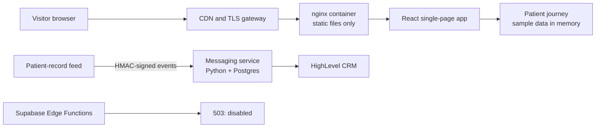
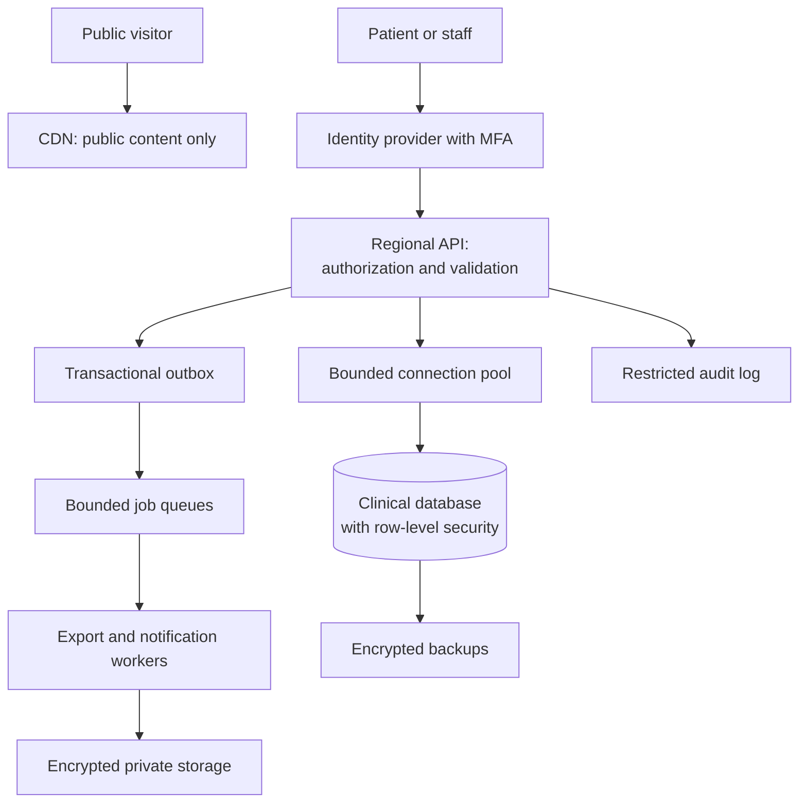

# Architecture

## Current system

**Public website.** A static React single-page app served by a hardened nginx container behind a TLS gateway and CDN. Routes are lazy-loaded. There is no server-side code and no database behind the site, so it can be cached aggressively and cannot leak patient data it never receives.

**Patient journey.** The `/experience` page runs a simplified version of the planned clinical access rules as pure functions in the browser (`src/lib/demo-policy.js`), against a fixed sample record. It omits care assignment and tenant membership, so any clinician can see the sample record. State lives in memory and resets on reload.

**Messaging service.** A separate Python service with its own Postgres database. It receives signed events from a patient-record feed, decides which campaign each patient belongs in, and projects that state into HighLevel CRM workflows. It shares no database or code with the website. See [Patient messaging](PATIENT-MESSAGING.md).

**Clinical backend prototype.** Eleven Supabase Edge Functions and eleven SQL migrations for intake, records, consent, FHIR export, notifications and payments. Every function returns `503 Service Unavailable` before running any logic, and the frontend has no client configured for it. It stays disabled until the [clinical release gates](CLINICAL-RELEASE.md) pass.

## Target clinical architecture

The design below is the target for a real clinical release. It is not built yet.

Principles:

- **Separate public and clinical traffic.** Public pages are cached at the edge; patient data never enters a shared cache.
- **The server decides access.** Patient, tenant, care assignment and role come from the verified identity on the server, never from the browser. Row-level security in the database is a second, independent layer.
- **Commit first, then notify.** A booking is confirmed by the database commit. Emails and SMS are sent afterwards from an outbox, so a failed notification never undoes or duplicates a booking.
- **Keep health data out of side channels.** No clinical details in URLs, logs, analytics, public caches or ordinary notifications.

## Key decisions

| Decision | Why | Trade-off |
|---|---|---|
| Static delivery for the public site | Cheap, fast and cacheable; no attack surface for patient data | Says nothing about clinical capacity |
| Stateless API workers | Workers can be replaced and scaled freely | Durable state must live in the database and queues |
| Regional data ownership | Meets data-residency rules and keeps consistency simple | Cross-region writes need explicit conflict handling |
| Database constraint on bookings | Prevents double bookings under concurrent requests | Requires transaction and retry testing |
| Transactional outbox | Jobs are created only for committed changes | Consumers must handle duplicates |
| Bounded concurrency and queues | Prevents cascading overload | Excess traffic is rejected instead of queued forever |
| Least privilege plus row-level security | Two independent barriers against data exposure | Privileged service paths need extra tests |
| Central configuration | Providers and content change without code changes | Settings need validation at startup |

## Clinical data lifecycle

1. Collect only the fields each purpose needs.
2. Verify identity and scope on every request.
3. Commit records under database constraints.
4. Write redacted audit events.
5. Run approved background jobs from the outbox.
6. Serve scoped reads and exports.
7. Apply retention schedules, legal holds and patient rights requests.
8. After any restore, re-apply deletions, consent withdrawals and holds before serving data.

Related: [API](API.md) · [Scalability](SCALABILITY.md) · [Operations](OPERATIONS.md) · [Threat model](THREAT-MODEL.md)
