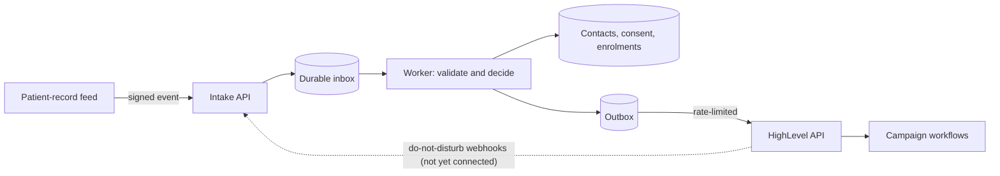

# Patient messaging service

The messaging service connects a patient-record (EHR) event feed to the HighLevel CRM. It decides which follow-up campaign each patient belongs in, keeps consent and opt-outs authoritative, and lets HighLevel workflows deliver the email and SMS steps. Its source lives in a separate private repository; this page documents its design and current status.

## Status

| Area | Status (November 2026) |
|---|---|
| Service | Live on its own HTTPS host, release pinned and verified against the local build |
| CRM | HighLevel developer sandbox location with sample contacts only |
| HighLevel setup | Custom fields, tags and all three workflows created and wired by ID |
| Sending | **Off.** Workflows are unpublished; enrolments wait until a publish decision. SMS steps are log-only |
| Data | Sample patient records only; no real patient feed is connected |
| Alerting | Email alerts through the project mail server; the server accepted a live alert, delivery to the mailbox not yet confirmed |

## Campaigns

| Campaign | Purpose | Steps | Channels |
|---|---|---|---|
| A. New patient intake | Welcome, first-visit preparation and booking follow-up | 9 | Email, SMS |
| B. Recall and reactivation | Patients with no visit inside the recall window | 11 | Email, SMS |
| C. Treatment follow-through | Accepted treatment plans not yet scheduled | 8 | Email, SMS |

All 28 messages are versioned templates with fallbacks (a missing first name becomes "there"). Links come only from a registry with fixed tracking parameters. A patient is in at most one campaign at a time, ranked A, then C, then B, with per-campaign and global cool-down periods.

## How it works

1. **Intake.** Each event is signed with HMAC-SHA256 over its timestamp and body. Size and signature are checked before parsing; stale timestamps and replays are rejected. Accepted events are stored in a durable Postgres inbox before the service acknowledges them.
2. **Validation.** Invalid events are quarantined with a recorded reason. An event that arrives before its patient's registration is retried. Each field tracks its own ordering, so an older event never overwrites newer data.
3. **Decision.** A single conditional update claims a campaign, so only one of several concurrent claims can win; a partial unique index is a second guard. Opt-outs, deaths and record merges are safety events: they are never dropped under load and always end active campaigns.
4. **Projection.** Each decision is written to an outbox, which syncs campaign state, tags and enrolments to HighLevel in per-patient order, with timeouts, bounded retries and a daily request budget. Every workflow step is designed to re-check consent and suppression before sending; because the workflows are unpublished, this check has not run yet.

## Safety controls

| Control | Behavior |
|---|---|
| Consent and suppression | Explicit or implied consent per channel. An opt-out immediately blocks new campaigns on that channel and is sent to HighLevel ahead of the request budget. Do-not-disturb webhooks are built and signature-checked but not yet registered in HighLevel |
| Quiet hours | Email 08:00–20:00 and SMS 09:00–19:00 in the patient's time zone, inside the US TCPA 8 a.m.–9 p.m. limit. Verified in simulation and tests; enforcement inside the HighLevel workflows is a pre-launch step |
| Kill switch | Audited pause and resume; while paused no new campaign is claimed. Pause takes about 0.1 s locally and was confirmed to flip HighLevel's pause flag on the live service |
| Volume limits | Per-run and per-hour enrolment caps. The daily budget holds back new enrolments only, never opt-outs (opt-outs remain subject to HighLevel's own rate limits) |
| Published workflows only | HighLevel accepts enrolments into Draft workflows but enrols nobody, so the service only enrols into published workflows and holds the rest |
| Identity protection | Contacts are created or updated by ID. When two patients share an email or phone, the shared field is left off the second contact and an alert is raised (verified live for a shared phone number) |
| Content lint | Flags sensitive clinical terms in subjects, previews, SMS text, sender names and URLs; rejects tracking pixels and unknown image hosts. All 28 templates pass |
| Link integrity | All 28 links passed a live check on 2026-11-25; the checker fails redirects that strip tracking parameters |
| Configuration drift | Fields, tags and workflow names, IDs and status are compared with the contract; Draft workflows are reported |
| Alerting | Failed syncs, rejected credentials, missing fields, unpublished workflows, identity collisions and budget exhaustion, rate-limited so a stuck condition cannot flood the inbox |

## Security

- Secrets come from the environment only. All changeable values live in one typed configuration file, and a test fails on hard-coded URLs or addresses.
- Separate database roles for migrations, runtime (data changes only) and read-only backups.
- Containers run with a read-only root filesystem, no Linux capabilities and `no-new-privileges`. Admin and metrics endpoints listen on loopback only; the public gateway returns 404 for them.
- Inbound webhooks are signature-checked and their IDs are remembered beyond the replay window.
- Every commit runs gitleaks, bandit and semgrep; every release runs pip-audit, mypy (strict) and lint.

## Reliability and recovery

- Durable inbox and outbox with idempotent processing: each event ID is applied once. Workers use `SKIP LOCKED` row locks with per-patient ordering, so several can run in parallel.
- If HighLevel rejects the access token, work is parked rather than failed, and recovery probes one operation per type, designed to avoid a retry storm after the credential is fixed (tested against a mock transport).
- Health, readiness and metrics endpoints report backlog age, failed, waiting and parked operations, and the remaining request budget.
- Daily logical backups (read-only role, 14-day retention). A local restore drill into an isolated container completed in 4 seconds with all migrations, contacts and enrolments present.
- Each release is installed by a hash-checked step, pinned and verified against the local build; the previous release is kept for rollback.

**Before real data:** backups must be encrypted and copied off the host, and a server-level restore and rollback must be rehearsed.

## Verification

| Evidence | Result |
|---|---|
| Automated tests | 157 passing; database, permission and concurrency tests run against real PostgreSQL 18 |
| Code review | 16 fresh-context review rounds; code findings fixed with regression tests |
| Mutation testing | 57 mutation checks run by the developer: each reverted fix is now caught by a test (five initially survived and their tests were tightened) |
| Live end-to-end (HighLevel sandbox) | Signature rejection and replay handling; campaigns A, B and C synced to HighLevel; opt-out sync; pause and resume; identity separation for a shared phone; enrolments into unpublished workflows held back |

Not yet verified: inbox placement, carrier SMS delivery and sender reputation. These need published workflows on a production CRM location and real sending, which carries per-message costs and is a separate decision.

## Scaling path

The expected bottleneck is the CRM API, not the service. Each HighLevel location has a burst limit and a daily request quota; the configuration keeps a safety margin under both. A contact sync costs 3 requests and an enrolment 4.

| Stage | Scale | Design |
|---|---|---|
| Current | One clinic, sample data | One worker, shared server, daily request budget |
| Multi-clinic | Many clinic locations | One HighLevel location per clinic with its own budget and token; tenant-scoped outbox |
| High volume | Hundreds of thousands of patients per day | Horizontal workers (already lock-safe), partitioned outbox, managed Postgres with pooling, agency-level OAuth app |
| Regional | 1M+ patients | Regional deployments near each clinic group, bulk sync path, at least 25% measured headroom |

Each stage is accepted on measured evidence; see [Scalability](SCALABILITY.md).

## Before real patients

- **HIPAA (US):** a signed business associate agreement with the CRM vendor and every subprocessor handling patient data; appointment and treatment messages kept separate from marketing.
- **TCPA and A2P 10DLC (US SMS):** documented consent, revocation honored on any channel, and registered sender campaigns. Marketing SMS may require prior express written consent; that is a legal decision per campaign.
- **CAN-SPAM:** the operator's real identity and postal address in every email, and a working unsubscribe. The address is a placeholder until a real operator is named.
- **GDPR, ePrivacy and Bangladesh law:** a lawful basis for each campaign, a transfer assessment and a retention schedule.

See [US and EU law](LEGAL-RESEARCH.md), [Bangladesh law](LEGAL-BANGLADESH.md) and [Clinical release](CLINICAL-RELEASE.md).
