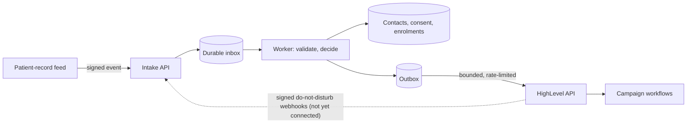

# Patient messaging service

The patient messaging service links a patient-record (EHR) event feed to the HighLevel (GoHighLevel)
CRM. It decides which follow-up campaign each patient belongs in, keeps consent and opt-outs
authoritative, and lets HighLevel workflows send the email and SMS steps. Status is as of 2026-11-25.
The source is kept in a separate private repository.

## Campaigns

| Campaign | Purpose | Steps | Channels |
|---|---|---|---|
| A: New patient intake | Welcome, first-visit preparation and booking follow-up | 9 | Email, SMS |
| B: Recall / reactivation | Patients with no visit inside the recall window | 11 | Email, SMS |
| C: Treatment follow-through | Accepted treatment plans that are not yet scheduled | 8 | Email, SMS |

All 28 messages are versioned templates. They render with fallbacks (a missing first name becomes
"there"), and links come only from a registry with fixed tracking parameters. Each patient is in at
most one campaign at a time, ranked A > C > B, with per-campaign and global cool-downs.

## Current release

| Area | Status on 2026-11-25 |
|---|---|
| Event service and worker | Live on its own HTTPS host on the project server, release 20261125-05, pinned, with hash parity checked |
| HighLevel location | A HighLevel developer sandbox sub-account holding sample contacts only. Production sending needs a production location as well as a publish decision |
| HighLevel configuration | Contract custom fields and tags are created. The three workflows are built and wired by id |
| Sending | **Off.** The workflows are not published, and enrolments wait (`waiting_config`) until a publish decision. SMS steps are log-only |
| Data | Sample patient records only. No real patient feed is connected |
| Alerting | E-mail alerts through the project mail server; the mail server accepted a real alert, and arrival in the mailbox has not yet been checked |

## How it works

1. **Intake.** Each event is signed with HMAC-SHA256 over the timestamp and body. The service checks
   the size and the signature before parsing. Stale timestamps and replays are refused. Accepted
   events are written to a durable Postgres inbox before the service acknowledges them.
2. **Validation.** An invalid event is quarantined whole, with the reason recorded. An event that
   arrives before its patient's registration is retried. Fact ordering is tracked per field, so an
   older event never overwrites newer data.
3. **Decision.** A single conditional update claims a campaign, so only one of several concurrent
   claims can win, and a partial unique index acts as a second guard. Opt-outs, deaths and merges are
   safety events: they are never shed for backlog, and they always end active campaigns.
4. **Projection.** Every decision goes to an outbox. The outbox writes campaign state, managed tags
   and workflow enrolments into HighLevel, ordered per patient, with timeouts, bounded retries and a
   daily request budget. Each workflow step is built to re-check the projected state, suppression
   tags and consent before sending; because the workflows are unpublished, this gate has not yet run.

## Safety controls

| Control | Behaviour |
|---|---|
| Consent and suppression | Explicit or implied consent per channel. An opt-out immediately blocks new campaign claims for that channel (or all channels) and queues the suppression to HighLevel ahead of the budget limit. HighLevel do-not-disturb webhooks are built and signature-checked in code; the webhook is not yet registered in HighLevel, so this path is not live |
| Quiet hours | Configured windows in the patient's own timezone (email 08:00–20:00, SMS 09:00–19:00, inside the US TCPA 8 a.m.–9 p.m. bound) are checked in simulation and tests. Enforcing them in the HighLevel workflows is a pre-publish step and is not verified |
| Kill switch | Pause and resume are audited; while paused, no new campaign is claimed. Measured at about 0.1 s in a local container built from the release image; on the live service, pause and resume flipped the HighLevel pause value |
| Volume limits | Per-run and per-hour enrolment caps. A daily HighLevel request budget holds back new enrolments only; stop traffic is not held by the budget (it is still subject to HighLevel's own rate limits) |
| Published-only enrolment | An enrolment goes only into a **published** workflow. HighLevel accepts an enrolment into a Draft workflow and enrols nobody, so those enrolments wait instead |
| Identity protection | Contacts are created, or updated by id. When two patients share an email or phone, HighLevel's duplicate refusal leaves the shared field off the second contact, and an alert is raised. The service no longer writes one patient's data onto another's contact (verified live for a shared phone) |
| Content lint | A copy lint flags sensitive clinical terms in subjects, preheaders, SMS text, sender names and URLs, and refuses tracking pixels and unknown image hosts (strict sensitive-term profile; all 28 templates pass it) |
| Link integrity | All 28 registered links passed a live check on 2026-11-25; the checker also fails redirects that strip tracking parameters (tested in code) |
| Configuration drift | Fields, tags and workflow names, ids and status are compared with the contract. Draft workflows are reported |
| Alerting | Failed projections, refused credentials, missing fields, unpublished workflows, identity collisions and budget exhaustion. Keys are rate-limited so a stuck condition cannot flood the mailbox |

## Security

- Secrets come from the environment only. Changeable values are in one typed configuration file,
  and a regression test fails on hard-coded URLs or addresses in source.
- Database roles are separate: migration, runtime with DML only, and a read-only backup role.
- Containers run with a read-only root filesystem, all capabilities dropped and `no-new-privileges`.
  The admin and metrics endpoints are reachable only on the server's loopback interface. The public
  gateway answers 404 for them.
- Inbound webhooks are signature-checked, and their ids are remembered beyond the replay window.
- Every commit runs gitleaks, bandit and semgrep. Releases run dependency audits (pip-audit), strict
  typing (mypy) and lint.

## Reliability and recovery

- The inbox and outbox are durable, and processing is idempotent: the same event id is stored and
  applied once. Workers use row locks (`SKIP LOCKED`) and per-patient ordering, so several workers
  can run in parallel.
- When HighLevel refuses the token, work is parked rather than failed. Each sweep then probes one op
  per kind, so recovery after a credential fix is designed to be bounded and not to cascade (tested
  against a mock transport).
- Health, readiness and metrics endpoints report backlog age, failed, waiting and parked operations,
  and the request budget.
- Daily logical backups are taken with a read-only role and kept for 14 days. A local restore drill
  into an isolated container passed in 4 seconds, with every migration, contact and enrolment present.
  Backups are not yet encrypted and sit on the same host as the database; encryption and an off-host
  copy are required before any real data. Server restore and rollback have not yet been drilled.
- Every release is installed by a hash-checked owner step, pinned, and verified against the local
  build, with the previous release kept for rollback.

## Verification

| Evidence | Result |
|---|---|
| Automated tests | 157 pass. Database, permission and concurrency tests run on real Postgres 18.6 |
| Independent review | 16 fresh-context review rounds; code findings were fixed with regression tests |
| Mutation checks | 57 builder-run mutation checks (review rounds 6–13): each reverted fix is now caught by a test; five first survived and their tests were tightened |
| Live end-to-end (2026-11-25, HighLevel sandbox location) | Signature refusal and replay handling; campaign decisions for A, B and C projected to HighLevel (contact, fields, tags); opt-out projection (suppression tag set, unenrolment accepted); pause and resume flipping the HighLevel pause value; identity separation for patients sharing a phone; enrolments into unpublished workflows parked instead of sent. No contact has been enrolled into a running workflow: the workflows are unpublished |

What is **not** verified yet: inbox placement, carrier SMS delivery and sender reputation. These need
published workflows on a production CRM location and real sending, which is a separate decision with
per-message costs.

## Scaling path

The binding limit is expected to be the CRM API, not the service. Each HighLevel location has a burst limit and a
daily request quota (the configuration keeps a safety margin under both). A contact sync costs 3
requests and an enrolment 4.

| Stage | Target | Design step |
|---|---|---|
| Current | One clinic location, sample data | One worker, shared server, daily request budget |
| Multi-clinic | Many clinic locations | One HighLevel location per clinic, per-location budgets and tokens, tenant-scoped outbox |
| High volume | Hundreds of thousands of patients per day | Horizontal workers (already lock-safe), partitioned outbox, managed Postgres with pooling, an agency-level marketplace app with OAuth |
| Regional | 1M+ patients under management | Regional deployments near each clinic group, an asynchronous bulk projection path, measured headroom of at least 25% |

Each stage is accepted only on measured evidence (see [capacity plan](CAPACITY-PLAN.md)).

## Before real patients

- **HIPAA (US):** a signed business associate agreement with the CRM vendor and every subprocessor
  that touches patient data. Appointment and treatment communications must be separated from
  marketing.
- **TCPA and A2P 10DLC (US SMS):** documented consent capture, honouring revocation on any channel,
  and registered sender campaigns. Whether implied consent is sufficient per channel and campaign is a
  legal decision; marketing SMS may require prior express written consent.
- **CAN-SPAM:** the operator's real postal address and identity in every email, and working
  unsubscribe. The address field is a placeholder until a real operator is named.
- **GDPR / ePrivacy (EU) and Bangladesh:** lawful basis for each campaign, transfer assessment and
  retention.

See [US/EU legal research](LEGAL-RESEARCH.md), [Bangladesh](LEGAL-BANGLADESH.md) and
[clinical release gates](CLINICAL-RELEASE.md).
